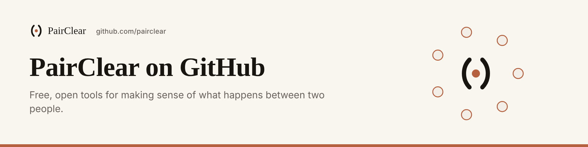

<a href="https://pairclear.com/en/?utm_source=github&utm_medium=profile&utm_campaign=org"><picture>
  <source media="(prefers-color-scheme: dark)" srcset="https://raw.githubusercontent.com/pairclear/.github/main/profile/banner-dark.png">
  
</picture></a>

**Free, open tools for making sense of what happens between two people.** Each one runs in your browser, sends nothing anywhere, and works in English and Russian. Made by [PairClear](https://pairclear.com/en/?utm_source=github&utm_medium=profile&utm_campaign=org), a site of short quizzes and plain articles about relationships.

**Бесплатные открытые инструменты**, чтобы разобраться, что происходит между двумя людьми. Работают в браузере, ничего не отправляют, на русском и английском. [PairClear по-русски →](https://pairclear.com/ru/?utm_source=github&utm_medium=profile&utm_campaign=org)

### For anyone in a relationship

<table>
<tr>
<td width="50%" valign="top">

<b><a href="https://github.com/pairclear/reflection-journal">Reflection journal</a></b> 
One question at a time: after a fight, before a hard talk, at the weekly check-in. <a href="https://pairclear.github.io/reflection-journal/">Open →</a>
</td>
<td width="50%" valign="top">

<b><a href="https://github.com/pairclear/conflict-thought-diary">Thoughts after a fight</a></b> 
A CBT thought diary for couples: separate what happened from what you told yourself. <a href="https://pairclear.github.io/conflict-thought-diary/">Open →</a>
</td>
</tr>
<tr>
<td width="50%" valign="top">

<b><a href="https://github.com/pairclear/relationship-questionnaires">Relationship questionnaires</a></b> 
Seven short, open questionnaires with a scoring rule anyone can check. <a href="https://pairclear.github.io/relationship-questionnaires/">Open →</a>
</td>
<td width="50%" valign="top">

<b><a href="https://github.com/pairclear/psychology-lenses">Psychology lenses</a></b> 
One situation through Freud, Jung, CBT, attachment theory and 4 more schools. <a href="https://pairclear.github.io/psychology-lenses/">Open →</a>
</td>
</tr>
<tr>
<td width="50%" valign="top">

<b><a href="https://github.com/pairclear/sixteen-associations">16 associations</a></b> 
Write 16 words about one topic and merge them in pairs down to one. <a href="https://pairclear.github.io/sixteen-associations/">Open →</a>
</td>
<td width="50%" valign="top"></td>
</tr>
</table>

### For people who build AI chats, and for practitioners

<table>
<tr>
<td width="50%" valign="top">

<b><a href="https://github.com/pairclear/not-a-therapist">Not a therapist</a></b> 
A system prompt, a Claude skill and 14 test scenarios: no diagnoses, no labels, crisis signs first.
</td>
<td width="50%" valign="top">

<b><a href="https://github.com/pairclear/couples-counseling-kit">Couples counselling kit</a></b> 
Intake and session templates, homework sheets and AI prompts for psychologists and coaches.
</td>
</tr>
</table>

### How we build them

- **Self-reflection, not diagnosis.** Nothing here measures your psyche or labels your partner.
- **Private by default.** No accounts, no analytics, no network requests from the tools.
- **Open.** Code under MIT, texts under CC BY 4.0. Translations and corrections are welcome: see [CONTRIBUTING](https://github.com/pairclear/.github/blob/main/CONTRIBUTING.md).

> These tools are not a crisis service. If you are thinking about hurting yourself, or you are afraid of your partner, call emergency services (112 in Europe, 911 in the US and Canada) or find a free helpline at [findahelpline.com](https://findahelpline.com).
